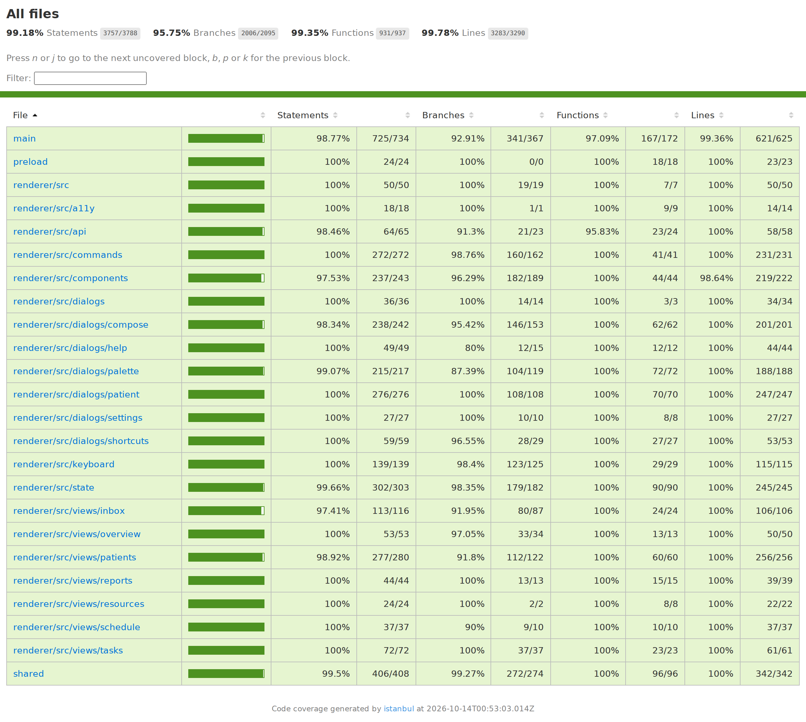

# CareConnect desktop: Week 9 accessibility testing report

Team DevIntel · SWEN 661 · tested on Tuesday, October 13, 2026

This report covers the CareConnect Electron app in `careconnect-electron/`, tested against WCAG 2.1 Level A and AA.
Every number here comes from tools that run on the code in this repository. The commands to repeat each test are at the end.

## Where each submission item is

| Item | Location |
|---|---|
| Accessibility testing report | This file |
| Conformance documentation (WCAG 2.1 AA) | [wcag-2.1-aa-conformance.md](wcag-2.1-aa-conformance.md) |
| axe results: reports and screenshots | [axe/README.md](axe/README.md) (after fixes), [axe/before-fixes.md](axe/before-fixes.md) (first run), one JSON report and one screenshot per screen in [axe/](axe/) |
| Screen reader testing notes | [screen-reader-notes.md](screen-reader-notes.md) |
| Evidence of keyboard navigation | [keyboard/README.md](keyboard/README.md) (12 tasks, Tab order, screenshots) |
| Issues fixed and how | [Issues found and fixed](#issues-found-and-fixed) below |
| Updated coverage report | [../coverage/html/index.html](../coverage/html/index.html), screenshot [../coverage/coverage-summary.png](../coverage/coverage-summary.png) |
| Statement on AI use | [How AI tools were used](#how-ai-tools-were-used) below |

## Results at a glance

| Test | Result |
|---|---|
| axe-core scan, WCAG 2.1 A/AA rules, 18 screens and dialogs | **0 violations**. The first run found 57, all for Label in Name (2.5.3), on 17 screens. |
| Contrast that axe marked "needs review" | 23 text nodes measured by the scan; **all meet 4.5:1 (or 3:1 for large text)** |
| Keyboard-only tasks in the built desktop app | **12 of 12 pass**. The Tab order is recorded with the focus ring at every stop. |
| Reflow at 320 CSS px and WCAG text spacing | **33 of 33 checks pass**. The first run found the 6 problems fixed below. |
| Screen reader (NVDA) | Test script and expected announcements are ready; the observed NVDA log will be added from the team's Windows run |
| Unit and integration tests | **2,092 tests in 85 suites pass** |
| Code coverage (threshold 60%) | **99.18% statements, 95.75% branches, 99.35% functions, 99.78% lines** |
| WCAG 2.1 AA conformance | **42 of 50 criteria supported, 8 not applicable, none failing.** NVDA confirmation is pending for 1.3.1, 4.1.2 and 4.1.3. |

## How we tested

| Tool | Version | What it checks | Command |
|---|---|---|---|
| axe-core, the engine inside the axe DevTools extension | 4.14.0 | Every WCAG 2.1 A/AA rule on 7 views, a filtered list, the in-app high contrast theme and 9 dialogs. It measures the colour contrast that axe leaves for review. | `npm run dev:web`, then `npm run test:axe` |
| axe DevTools browser extension | Chrome on Windows | The same rules, run by hand on the same pages | open http://localhost:5173 in Chrome |
| Chromium driven by Playwright | Chromium 153.0.8010.12, playwright-core 1.63.0 | Runs the scan and the layout checks in a real browser, so layout and colour are real | (used by the scripts) |
| Keyboard walkthrough | Electron 44.5.1 | Starts the built app in a fresh profile, then uses only key presses. It checks each result and records the Tab order and focus outline. | `npm run build`, then `npm run test:keyboard` |
| Layout checks | Chromium 153 | Reflow at 320 × 256 CSS px (1.4.10) and WCAG text spacing (1.4.12) on every view and dialog | `npm run test:layout` |
| Jest, React Testing Library, jest-axe | Jest 30.5.2, jest-axe 11.0.0 | 2,092 unit, component and IPC/window integration tests, including an axe check of every component and dialog. They also check accessible names with the browser algorithm (`dom-accessibility-api`). | `npm test -- --coverage` |
| NVDA with Chrome and the desktop app | Windows 11 | What a screen reader user hears | [screen-reader-notes.md](screen-reader-notes.md) |

**Browser preview.** axe DevTools runs in Chrome, but CareConnect is a desktop app.
`npm run dev:web` serves the same React screens on their own at http://localhost:5173. In the browser, a small API keeps the synthetic data in the browser's local storage.
Desktop-only features have no browser version, so they are covered elsewhere:
- file dialogs, the tray, notifications and the native menus are covered by the Jest integration tests and the keyboard walkthrough in Electron;
- the native menu structure is read from the running app (see [keyboard/README.md](keyboard/README.md#native-menu-bar)).

## Results by screen

| Screen or dialog | axe violations, first run → now | Reflow at 320 px | Text spacing | Keyboard task |
|---|---|---|---|---|
| Overview | 6 → 0 | Pass | Pass | Tab order |
| Schedule | 1 → 0 | Pass | Pass | — |
| Patients (Avery Park selected) | 14 → 0 | Pass | Pass | 1–7 |
| Patients, list searched for "riley" | 7 → 0 | — | — | 5 |
| Patients, in-app high contrast theme | not in first run → 0 | — | — | — |
| Inbox (conversation open) | 8 → 0 | Pass | Pass after fix 7 | 9 |
| Tasks | 1 → 0 | Pass | Pass | 10 |
| Reports | 1 → 0 | Pass after fix 5 | Pass | — |
| Resources | 1 → 0 | Pass | Pass | — |
| Command palette (Ctrl+K) | 10 → 0 | Pass | Pass | 8 |
| Keyboard shortcuts (Ctrl+/) | 1 → 0 | Pass after fix 6 | Pass | 12 |
| Help (F1) | 1 → 0 | Pass after fix 6 | Pass | 12 |
| Settings (Ctrl+,) | 1 → 0 | Pass | Pass | — |
| New patient (Ctrl+N), with errors showing | 1 → 0 | Pass | Pass | 11 |
| Add clinical note (N) | 1 → 0 | Pass | Pass | 6 |
| Edit care summary (E) | 1 → 0 | Pass | Pass | 7 |
| New message (Ctrl+Shift+M) | 1 → 0 | Pass | Pass | — |
| Reply (R) | 1 → 0 | Pass | Pass | 9 |
| Skip links, while visible | — | — | Pass | 1 |

The axe reports list every rule that passed and every node checked: one JSON file per screen in [axe/](axe/).
[axe/accessibility-tree/](axe/accessibility-tree/) holds what Chromium exposes to assistive technology on each screen.

## Issues found and fixed

| # | Issue | WCAG | Found by | Fix | Verified by | Commit |
|---|---|---|---|---|---|---|
| 1 | 57 controls on 17 screens had an `aria-label` that left out some of their visible text. Examples include the Esc keycap on every dialog's Close button, the Inbox button's unread badge, and the details in patient rows, stat cards and palette options. A speech-input user says what they see, so the name must contain the visible label. | 2.5.3 Label in Name (A) | axe-core 4.14 | Removed every `aria-label` override. Where the spoken name needs more than the visible words, it comes from one visually hidden span that starts with them, and the visible pieces are hidden from screen readers. The Inbox button still reads "Inbox, 4 unread". | axe: 0 violations on 18 screens. The tests now check the name the browser computes, not an attribute. | 15d05e2 |
| 2 | After a skip link or a click on a region's background, F6 remembered the region itself. The next F6 into that region focused the empty container instead of the last control used there. | 2.4.3 Focus Order (A) | Keyboard walkthrough | F6 only remembers controls inside a region, never the region element. | New unit test; walkthrough task 2 passes | 19cf811 |
| 3 | Single-character shortcuts (E, N, M, R, /, and G then a letter) could not be turned off. A speech-input user who says a word starting with one of those letters can trigger a command by accident. | 2.1.4 Character Key Shortcuts (A) | Manual review against the criterion | Added a Settings → Keyboard → "Single-key shortcuts" switch, on by default. When off, those keys do nothing. Their hints and `aria-keyshortcuts` disappear, and the shortcuts reference says they are off. Ctrl/⌘ shortcuts and function keys always work. | 16 new tests: the key handler, switching while the app runs, Settings, hints, toolbar, reference dialog, and validation of saved files | 19cf811 |
| 4 | The command palette closed when the mouse button went *down* on the backdrop. | 2.5.2 Pointer Cancellation (A) | Code review | Dialogs now close when the button is *released*, and only if both press and release were on the backdrop. Moving off before letting go cancels. A drag that starts inside the dialog never closes it. | Updated and new Dialog and palette tests | 19cf811 |
| 5 | The Reports tables were 340 px wide in a 320 px window, so the page scrolled sideways. | 1.4.10 Reflow (AA) | Layout check | Narrower table cells below 480 px | Layout check: Reports passes | 114f918 |
| 6 | At 320 px the Keyboard shortcuts dialog was 350–370 px wide, and Help text was cut off at the dialog's right edge (325 px). | 1.4.10 Reflow (AA) | Layout check | Each dialog's content grid uses one column that can shrink. Keycaps wrap, and the "Open keyboard shortcuts" button label wraps. | Layout check: both dialogs pass | 114f918 |
| 7 | With WCAG text spacing applied, conversation names and subjects in the Inbox list were cut off with "…". | 1.4.12 Text Spacing (AA) | Layout check | Names and subjects now wrap onto a second line instead of being shortened. | Layout check: Inbox passes | 114f918 |

A first measurement, before the layout script existed, found the Reports table 20 px too wide (fix 5).
The script's first run then passed 11 of 26 checks:
- the two dialogs in fix 6 failed reflow;
- every text-spacing check failed, because the check counted the skip links (hidden until focused) and the one-line Inbox message preview (short by design; the full message is in the reading pane).

We corrected the check, and it passed 24 of 27, with fixes 6 and 7 still to do. The corrected check:
- ignores visually hidden text;
- fails only text that the extra spacing cuts off;
- tests the skip links while they are visible.

After fixes 6 and 7 it passed 27 of 27. With the Add note, Edit summary and Reply dialogs added, the final result is 33 of 33.

The keyboard walkthrough failed 6 of its 12 tasks on its first run. Most failures were mistakes in the script. For example, it expected focus in the note text when the Add note dialog opens on its note-type list, and it did not know a date input takes three Tab stops. One failure was a real bug, issue 2.

## Keyboard navigation evidence

[keyboard/README.md](keyboard/README.md) is generated from the built desktop app with no mouse use after launch. It records:

- **12 tasks done with keys only**, each with the keys pressed, the expected result and what the app did:
  - the skip links, then F6 and Shift+F6 between regions;
  - arrow keys in the toolbar and patient list;
  - "/" search with the result count announced;
  - adding a note with Ctrl+Enter, and Escape closing a dialog and returning focus;
  - the command palette, replying to a message, completing a task and creating a patient;
  - opening the shortcuts reference and Help.
- **The Tab order from launch.** The first 21 stops are the skip links, the sidebar, the toolbar, the patient search and list, the patient's actions and the status bar, after which the order wraps. Every stop shows the 3 px teal (#008F89) focus outline. Toolbars and lists are a single Tab stop, and arrow keys move inside them.
- **Screenshots** of focus in the skip links, toolbar, patient list, dialogs and task list.
- **The native menu structure**, read from the running app. The menus open with Alt or F10.

## Screen reader testing

[screen-reader-notes.md](screen-reader-notes.md) has the NVDA test script and, for each step, the expected announcement. The expected text comes from the accessibility tree Chromium builds for each screen.
The observed NVDA output will be recorded in the same file from the team's Windows run.
The Jest suite also checks many of the same names, states and announcements.

## Coverage



`npm test -- --coverage` covers the main process, preload, shared code and renderer (`src/**`). A copy of the HTML report from this run is in [../coverage/html/](../coverage/html/index.html), with the totals in [../coverage/coverage-summary.json](../coverage/coverage-summary.json).
The configured threshold is 60% for each measure, and the run passes it in all four.

## Limits of this testing

- Automated tools find only part of WCAG. The [conformance table](wcag-2.1-aa-conformance.md) therefore gives evidence for each of the 50 criteria, not only the ones axe checks.
- VoiceOver on macOS was not tested; the team tests on Windows.
- Windows High Contrast mode (forced colours) was not part of this week's tests. The app's `forced-colors` styles did not change this week. The in-app high contrast theme was scanned with axe (0 violations).

## How to repeat these tests

From `careconnect-electron/`:

```bash
npm ci
npm run typecheck && npm run lint
npm test -- --coverage            # 2,092 tests and the coverage report in coverage/lcov-report/
npm run dev:web                   # terminal 1: http://localhost:5173 (also for the axe DevTools extension)
npm run test:axe                  # terminal 2: rewrites docs/accessibility/axe/
npm run test:layout               # terminal 2: rewrites docs/accessibility/layout/
npm run build && npm run test:keyboard   # rewrites docs/accessibility/keyboard/
```

On Windows Subsystem for Linux, run `test:keyboard` with `env -u ELECTRON_RUN_AS_NODE` if VS Code's terminal sets that variable.

## How AI tools were used

Shane Cray used Claude Code (Anthropic's Claude Opus 5.5 model) as a coding assistant for this week's testing work.
Claude Code wrote the axe, layout and keyboard test scripts. It also made the fixes listed above with their tests and drafted these documents.
Shane directed the work and reviewed each change before it was committed.
Every result in these documents comes from running the tests on this code, and the tests were re-run after each fix.
