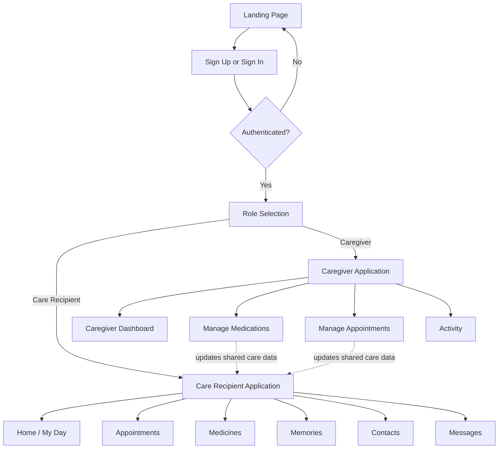

# CareConnect


A responsive, accessible care-support Web application for care recipients who need help remembering daily tasks and for the caregivers who support them.

CareConnect is built with React, TypeScript, and Vite as an installable Progressive Web App with accessibility integrated throughout the user experience.

> Developed as a University of Maryland Global Campus SWEN 661 course project.

---

## Live Application

**CareConnect Web**  
https://careconnect-web-swen661.netlify.app

The production application is publicly accessible over HTTPS and supports Progressive Web App installation.

---

## Public Coverage Report

**Interactive Jest/Istanbul Coverage Report**  
https://sims-007.github.io/swen661-devintel/coverage/

Published Web coverage:

| Metric | Coverage |
|---|---:|
| Statements | **87.69%** |
| Branches | **80.35%** |
| Functions | **84.96%** |
| Lines | **88.38%** |

All reported coverage categories exceed 80%.

---

## Table of Contents

- About
- Who It Is For
- Key Features
- Accessibility
- Technology Stack
- Architecture
- Project Structure
- Application Flow
- Getting Started
- Available Scripts
- Testing
- Code Coverage
- PWA
- Deployment
- Screens and Walkthrough
- Known Limitations
- Roadmap
- Authors
- License
- Acknowledgments
- Disclaimer

---

## About

CareConnect reduces daily cognitive load for people who need help remembering important activities while giving caregivers visibility into schedules, medications, appointments, messages, and care-related activity.

The care-recipient experience emphasizes **recognition over recall** through:

- clear orientation information
- plain language
- large interaction targets
- simplified navigation
- visible status information
- limited cognitive overload
- caregiver contact access
- predictable interaction patterns

The caregiver experience provides a denser interface for managing care information while remaining accessible and consistent with the care-recipient experience.

Both roles share a common component system, application state, routing architecture, and accessibility patterns.

---

## Who It Is For

### Care Recipients

Care recipients who benefit from:

- calm, low-clutter screens
- large targets
- clear navigation
- plain-language instructions
- reminders and orientation cues
- simple access to caregivers
- reduced memory demands

### Caregivers

Caregivers who need:

- visibility into daily care activity
- medication management
- appointment management
- activity review
- messaging
- care-recipient support tools
- role-based access to care information

---

# Key Features

## Care Recipient

- Home dashboard
- My Day / daily schedule
- Next-task guidance
- Appointments
- Medicines
- Memories
- Contacts
- Messages
- Help
- Caregiver communication
- Check-in support
- Quick actions
- Accessible chatbot assistance
- Accessibility controls
- Caregiver role switching

## Caregiver

- Caregiver dashboard
- Activity review
- Appointment management
- Medication management
- Messaging
- Care-recipient support information
- Care notes and care-management functionality
- Role switching

## Shared

- public landing page
- sign in and sign up
- role selection
- protected application routes
- accessible forms
- reusable accessible components
- responsive interface
- light and dark modes
- adjustable text size
- keyboard support
- screen-reader support
- installable Progressive Web App

---

# Accessibility

CareConnect was designed and tested with WCAG 2.1 Level AA principles in mind.

Accessibility features include:

- semantic HTML
- keyboard-operable controls
- visible focus states
- ARIA labels and states
- accessible form labels
- status and alert announcements
- logical navigation
- responsive reflow
- large interaction targets
- adjustable text sizes
- light and dark themes
- screen-reader compatibility
- reduced cognitive load
- role-appropriate navigation and layout

## Accessibility Controls

The application includes built-in controls for:

- **A** — default text size
- **A+** — larger text
- **A++** — extra-large text
- light mode
- dark mode
- quick family/caregiver calling

---

## Final Accessibility Verification

| Test | Result |
|---|---:|
| Lighthouse Accessibility | **100/100** |
| axe DevTools | **0 issues** |
| WAVE Errors | **0** |
| WAVE Contrast Errors | **0** |
| WAVE AIM Score | **10/10** |
| Keyboard-only Testing | **Completed** |
| NVDA Screen Reader Testing | **Completed** |
| Google Chrome Testing | **Completed** |
| Microsoft Edge Testing | **Completed** |

Automated accessibility tools can detect only a subset of accessibility issues. CareConnect therefore also underwent manual keyboard and NVDA screen-reader testing.

One WAVE advisory identifying a possible heading was manually reviewed and was not classified by WAVE as an accessibility error.

---

# Technology Stack

| Layer | Technology |
|---|---|
| Framework | React 18 + Vite |
| Language | TypeScript |
| Routing | React Router |
| State | React Context / application state |
| Persistence | Local/client-side data stores and mock data |
| Testing | Jest + React Testing Library |
| Coverage | Istanbul / Jest Coverage |
| Accessibility | Semantic HTML, ARIA, manual and automated testing |
| PWA | Web App Manifest + Service Worker |
| Deployment | Netlify |
| Coverage Hosting | GitHub Pages |

---

# Architecture Overview

```text
Browser / PWA
      |
      v
React + Vite Application
      |
      +--> Authentication Context
      |
      +--> Application Context / State
      |
      +--> React Router
      |
      +--> Care Recipient UI
      |
      +--> Caregiver UI
      |
      +--> Shared Accessible Components
      |
      +--> Local/Data Stores
      |
      +--> Service Worker
             |
             +--> PWA / Offline Support
```

## Application Entry

```text
index.html
    |
    v
src/main.tsx
    |
    v
src/App.tsx
```

---

# Application Flow



---

# Project Structure

Representative Web application structure:

```text
careconnect-web/
|
├── public/
│   ├── icons/
│   ├── manifest.webmanifest
│   └── _redirects
|
├── src/
│   ├── auth/
│   ├── components/
│   ├── context/
│   ├── data/
│   ├── pages/
│   ├── pwa/
│   ├── test/
│   ├── App.tsx
│   └── main.tsx
|
├── docs/
├── coverage/
├── babel.config.cjs
├── jest.config.js
├── package.json
├── README.md
└── index.html
```

---

# Representative Routes

```text
/
/signin
/signup
/role
/app
/app/schedule
/app/appointments
/app/medications
/app/memories
/app/contacts
/app/messages
/app/help
/app/caregiver
/app/activity
/app/manage-medications
/app/manage-appointments
```

Netlify SPA fallback routing is configured in:

```text
public/_redirects
```

with:

```text
/*    /index.html   200
```

This allows direct URLs such as `/app/appointments` to load correctly instead of returning a server-side 404.

---

# Getting Started

## Prerequisites

Install:

- Node.js
- npm
- Git
- a modern browser such as Chrome or Microsoft Edge

Recommended development and accessibility tools:

- Visual Studio Code
- axe DevTools
- WAVE
- NVDA

Verify Node.js and npm:

```bash
node --version
npm --version
```

---

## Clone the Repository

```bash
git clone https://github.com/sims-007/swen661-devintel.git
```

Switch to the finalized Web branch if needed:

```bash
git checkout week12-web-integration
```

Navigate to the Web project:

```bash
cd careconnect-web
```

Install dependencies:

```bash
npm install
```

Windows PowerShell:

```powershell
npm.cmd install
```

---

# Run the Application

Development server:

```bash
npm run dev
```

Windows PowerShell:

```powershell
npm.cmd run dev -- --host 127.0.0.1 --port 5174
```

Open:

```text
http://127.0.0.1:5174/
```

---

# Available Scripts

| Script | Purpose |
|---|---|
| `npm run dev` | Start Vite development server |
| `npm run build` | Generate production build |
| `npm run preview` | Preview production build |
| `npm run typecheck` | Run TypeScript checking |
| `npm test` | Run Jest automated tests |
| `npm run coverage` | Run Jest tests with coverage |
| `npm run test:watch` | Run Jest in watch mode |

Windows PowerShell users can invoke the same scripts with `npm.cmd`.

---

# Type Checking

```bash
npm run typecheck
```

Windows:

```powershell
npm.cmd run typecheck
```

---

# Automated Testing

Run:

```bash
npm test
```

Windows:

```powershell
npm.cmd test
```

Final verified Web test results:

```text
Test Suites: 53 passed, 53 total
Tests:       724 passed, 724 total
Failures:    0
```

The automated suite covers application behavior across:

- authentication
- navigation
- routing
- reusable components
- application context
- local/data stores
- care-recipient pages
- caregiver pages
- appointments
- medication functionality
- messaging
- forms
- confirmation dialogs
- accessibility controls
- application entry behavior

---

# Code Coverage

Generate coverage:

```bash
npm run coverage
```

Windows:

```powershell
npm.cmd run coverage
```

Published results:

| Metric | Coverage |
|---|---:|
| Statements | **87.69%** |
| Branches | **80.35%** |
| Functions | **84.96%** |
| Lines | **88.38%** |

All four reported coverage categories exceed 80%.

## Interactive Coverage Report

The full HTML Jest/Istanbul report is publicly available through GitHub Pages:

**https://sims-007.github.io/swen661-devintel/coverage/**

The report provides:

- overall coverage
- directory-level coverage
- file-level coverage
- covered statements
- uncovered statements
- branch coverage
- function coverage
- line coverage

Coverage is published from a dedicated `gh-pages` branch so the interactive report can remain independently accessible.

---

# Production Build

Generate:

```bash
npm run build
```

Windows:

```powershell
npm.cmd run build
```

Production output:

```text
dist/
```

Typical production build contents include:

```text
dist/
├── assets/
├── icons/
├── _redirects
├── index.html
├── manifest.webmanifest
└── sw.js
```

---

# Production Preview

Run:

```bash
npm run preview
```

Windows:

```powershell
npm.cmd run preview -- --host 127.0.0.1 --port 4173
```

Open:

```text
http://127.0.0.1:4173/
```

Production preview was used to verify:

- production assets
- routing
- manifest behavior
- service worker
- PWA installation
- accessibility behavior

---

# Progressive Web App

CareConnect Web is configured as an installable PWA.

Verified PWA functionality includes:

- Web App Manifest
- registered service worker
- active service worker
- browser installation support
- CareConnect installation interface
- production HTTPS deployment
- application start URL
- offline-support architecture

The production PWA was verified using Chrome DevTools under:

```text
Application → Manifest
Application → Service Workers
```

---

# Deployment

The Web application is publicly deployed through Netlify.

## Live Application

**https://careconnect-web-swen661.netlify.app**

Deployment characteristics:

```text
Framework:         React + Vite
Production output: dist/
SPA fallback:      public/_redirects
HTTPS:             Enabled
PWA:               Enabled
```

The live deployment was verified for:

- public access
- HTTPS
- React application rendering
- direct-route navigation
- Care Recipient experience
- Caregiver experience
- production JavaScript and CSS assets
- Manifest
- Service Worker
- PWA installation
- Chrome
- Microsoft Edge

---

# Browser Testing

The final Web application was tested in:

- Google Chrome
- Microsoft Edge

Browser testing included:

- landing page
- authentication screens
- role selection
- navigation
- Care Recipient views
- Caregiver views
- forms
- dialogs
- accessibility controls
- direct URLs
- responsive layout
- PWA behavior

---

# Screens and Walkthrough

The project includes user-interface views for the following major workflows:

1. Landing page
2. Accessible assistant
3. Sign up
4. Sign in
5. Role selection
6. Care Recipient Home
7. My Day
8. Medications
9. Appointments
10. Memories
11. Contacts
12. Messages
13. Caregiver dashboard
14. Caregiver medication management
15. Caregiver appointment management
16. Activity review

Screenshots used in project documentation should be stored under the appropriate project documentation directory.

---

# Accessibility Testing Procedure

Accessibility validation included:

### Lighthouse

Final Accessibility score:

```text
100 / 100
```

### axe DevTools

Final result:

```text
0 issues
```

### WAVE

Final results:

```text
Errors:           0
Contrast Errors:  0
AIM Score:        10 / 10
```

### Keyboard Testing

Manual keyboard testing evaluated:

- logical tab order
- interactive control focusability
- visible focus
- navigation
- forms
- dialogs
- role switching
- quick actions

### NVDA

NVDA testing evaluated:

- labels
- headings
- navigation
- button names
- form fields
- roles
- status announcements
- application structure

---

# Data and API Architecture

The evaluated academic Web application primarily uses local/client-side state and demonstration data.

A production healthcare backend is outside the scope of the evaluated academic implementation.

The architecture can be extended to support:

- REST APIs
- GraphQL
- secure cloud databases
- production authentication
- healthcare-system integration
- caregiver synchronization
- push notifications
- secure patient profiles

---

# Known Limitations

- The application is an academic prototype.
- Production healthcare backend services are outside the evaluated scope.
- Demonstration and mock data are used in areas of the application.
- Automated accessibility tools cannot evaluate every WCAG success criterion.
- Accessibility should be retested after significant UI changes.
- PWA installation assets can be expanded with additional screenshots and icon variants.
- The application must not be used to store real protected health information in its current academic configuration.

---

# Roadmap

Potential future improvements include:

- production backend integration
- secure cloud synchronization
- expanded caregiver collaboration
- push-notification reminders
- richer offline functionality
- localization and bilingual support
- expanded PWA assets
- automated CI/CD
- automated accessibility regression testing
- expanded browser/device testing
- healthcare-system interoperability

---

# Final Web Verification

```text
Automated Tests
---------------
Test Suites: 53 / 53 passed
Tests:       724 / 724 passed
Failures:    0

Coverage
--------
Statements: 87.69%
Branches:   80.35%
Functions:  84.96%
Lines:      88.38%

Accessibility
-------------
Lighthouse:          100 / 100
axe DevTools:        0 issues
WAVE Errors:         0
WAVE Contrast:       0
WAVE AIM Score:      10 / 10
Keyboard Testing:    Completed
NVDA Testing:        Completed

Browser Verification
--------------------
Google Chrome:       Completed
Microsoft Edge:      Completed

PWA
---
Manifest:            Verified
Service Worker:      Verified
Installation:        Verified

Deployment
----------
Public HTTPS Site:   Verified
```

---

# Authors

### Alireza Minagar — Author & Developer

AI/ML Software Engineer · Founder & CTO, Perfect Strokes LLC · Adjunct Professor, UMGC.

Physician-scientist turned software engineer, with graduate work in Bioinformatics, Software Engineering, and Cybersecurity, focused on the intersection of healthcare and applied AI/ML.

GitHub: `https://github.com/aliminagar`  
LinkedIn: `https://www.linkedin.com/in/alireza-minagar-ai`  
Website: `https://alirezaminagar-md.netlify.app/`

### SWEN 661 Team Contributors

Additional contributors should be listed here with their project roles and responsibilities.

---

# License

Distributed under the MIT License. See `LICENSE` for full license text.

---

# Acknowledgments

- University of Maryland Global Campus — SWEN 661
- WCAG 2.1 Guidelines
- WAI-ARIA Authoring Practices
- React
- Vite
- Jest
- React Testing Library
- Netlify
- GitHub Pages

---

# Disclaimer

CareConnect is an educational prototype built as a course artifact.

It is **not a medical device**, provides no medical, dosage, or clinical advice, and must not be used for real patient care or to manage actual medications.

The academic implementation uses demonstration/mock data and is not intended to store real protected health information (PHI).

For real healthcare decisions, consult a licensed healthcare professional.

---

## Final Project Links

**Live CareConnect Web Application**  
https://careconnect-web-swen661.netlify.app

**Interactive Web Coverage Report**  
https://sims-007.github.io/swen661-devintel/coverage/

---

**CareConnect — accessible care support across platforms.**